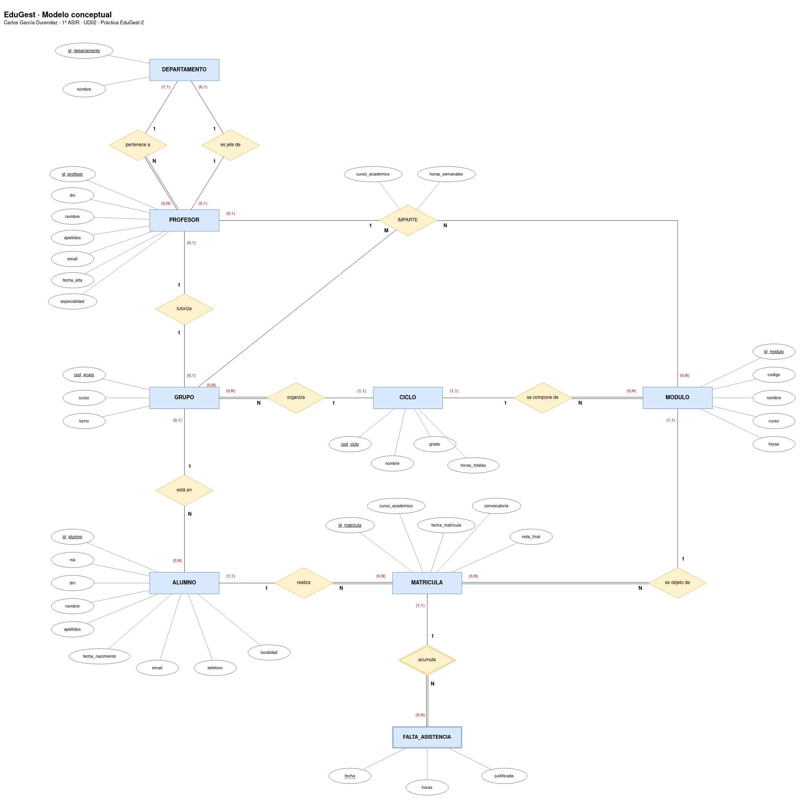

# EduGest · UD02 · Modelo conceptual (E/R)

| | |
|---|---|
| **Proyecto** | EduGest: gestión académica del IES Serra Gelada |
| **Práctica** | EduGest-2 (RA6: a, d, e, h) |
| **Autor** | Carlos García Durendez (1º ASIR semipresencial) |
| **Fecha** | 2026-11-15 |
| **Herramienta** | draw.io |

---

## 1. Diagrama entidad/relación

Fichero fuente: [02-modelo-er.drawio](02-modelo-er.drawio).

### 1.1 Notación (Chen extendida)

| Símbolo | Significado |
|---|---|
| Rectángulo | Entidad |
| Rectángulo doble | Entidad débil (`FALTA_ASISTENCIA`) |
| Rombo | Relación |
| Rombo doble | Relación identificadora de una entidad débil (`acumula`) |
| Elipse | Atributo |
| Atributo <u>subrayado</u> | Identificador (clave) de la entidad |
| Subrayado discontinuo | Discriminante de la entidad débil (`fecha`) |
| Línea doble | Participación **total**: toda instancia de la entidad participa en la relación (mínimo 1) |
| Línea sencilla | Participación **parcial** (mínimo 0) |
| **(mín, máx)** junto a una entidad | Con cuántas instancias de esa entidad se relaciona **una** instancia de la otra |
| **1 / N / M** junto al rombo | Cardinalidad máxima de la relación (tipo de correspondencia) |

En la ternaria `IMPARTE`, el par (mín, máx) junto a una entidad indica cuántas instancias de ella se relacionan con **cada pareja** de las otras dos, dentro de un mismo curso académico.

---

## 2. Entidades y relaciones

### 2.1 Entidades identificadas

| Sustantivo de la entrevista | ¿Entidad? | Motivo |
|---|---|---|
| Ciclo formativo | Sí → `CICLO` | Tiene código, nombre, grado y horas propios |
| Módulo profesional | Sí → `MODULO` | Tiene código, nombre, curso y horas. Muchas instancias |
| Grupo | Sí → `GRUPO` | Tiene código, curso y turno, y se relaciona con alumnos, ciclo y profesorado |
| Alumno | Sí → `ALUMNO` | Muchos atributos propios |
| Profesor | Sí → `PROFESOR` | Muchos atributos propios |
| Departamento | Sí → `DEPARTAMENTO` | Nombre único y un jefe. Agrupa profesorado |
| Matrícula | Sí → `MATRICULA` | Tiene atributos propios y además se relaciona con las faltas (ver S4) |
| Falta de asistencia | Sí → `FALTA_ASISTENCIA` (débil) | Tiene día, horas y justificación. Solo tiene sentido dentro de una matrícula |
| Curso académico (2025-26) | No | Es un valor que describe una matrícula o una asignación de docencia → atributo |
| Turno, grado, convocatoria | No | Son valores de un atributo, sin propiedades propias |
| Tutor | No (rol) | Es un profesor que cumple un papel → relación `tutoriza` |
| Jefe de departamento | No (rol) | Es un profesor que cumple un papel → relación `es jefe de` |
| Especialidad, localidad | No | La entrevista solo pide guardar el valor → atributo |

### 2.2 Relaciones y cardinalidades

| Relación | Entidades | Tipo | Cardinalidades | Justificación |
|---|---|---|---|---|
| `pertenece a` | PROFESOR – DEPARTAMENTO | 1:N | Un profesor pertenece a (1,1) departamento. Un departamento tiene (0,N) profesores | «el departamento al que pertenece» (uno). Un departamento recién creado puede no tener profesorado (S7) |
| `es jefe de` | PROFESOR – DEPARTAMENTO | 1:1 | Un departamento tiene (0,1) jefe. Un profesor es jefe de (0,1) departamento | Es un rol distinto de la pertenencia, por eso es otra relación. El jefe puede faltar temporalmente (S7) |
| `tutoriza` | PROFESOR – GRUPO | 1:1 | Un grupo tiene (0,1) tutor. Un profesor tutoriza (0,1) grupo | «puede tener un tutor» y «un profesor solo puede tutorizar un grupo» |
| `organiza` | CICLO – GRUPO | 1:N | Un grupo es de (1,1) ciclo. Un ciclo tiene (0,N) grupos | «cada grupo pertenece a un ciclo». SMR aún no tiene grupos |
| `se compone de` | CICLO – MODULO | 1:N | Un módulo es de (1,1) ciclo. Un ciclo tiene (0,N) módulos | 0484 de DAM y 0484 de DAW son módulos distintos (S2) |
| `está en` | ALUMNO – GRUPO | 1:N | Un alumno está en (0,1) grupo. Un grupo tiene (0,N) alumnos | «algunos alumnos todavía no tienen grupo» |
| `realiza` | ALUMNO – MATRICULA | 1:N | Una matrícula es de (1,1) alumno. Un alumno tiene (0,N) matrículas | Un alumno se matricula de varios módulos y cursos |
| `es objeto de` | MODULO – MATRICULA | 1:N | Una matrícula es de (1,1) módulo. Un módulo tiene (0,N) matrículas | Un módulo lo cursan muchos alumnos |
| `acumula` (identificadora) | MATRICULA – FALTA_ASISTENCIA | 1:N | Una falta es de (1,1) matrícula. Una matrícula tiene (0,N) faltas | «una falta se refiere a la matrícula de un alumno en un módulo concreto» |
| `IMPARTE` (ternaria) | PROFESOR – MODULO – GRUPO | 1:N:M | Para un módulo y un grupo: (0,1) profesor. Para un profesor y un grupo: (0,N) módulos. Para un profesor y un módulo: (0,N) grupos | «qué profesor imparte cada módulo a cada grupo en cada curso académico» (S6) |

---

## 3. Diccionario de datos

Columna **Identificador**: **PK** = identificador principal · **UK** = identificador alternativo (único) · **D** = discriminante de entidad débil · — = no identifica.

### DEPARTAMENTO

| Atributo | Descripción | Dominio | Obligatorio | Identificador |
|---|---|---|---|---|
| id_departamento | Identificador interno del departamento | Entero positivo | Sí | PK |
| nombre | Nombre del departamento (Informática, Matemáticas…) | Texto (50) | Sí | UK |

### PROFESOR

| Atributo | Descripción | Dominio | Obligatorio | Identificador |
|---|---|---|---|---|
| id_profesor | Identificador interno del profesor | Entero positivo | Sí | PK |
| dni | DNI o NIE del profesor | Texto (9): 8 dígitos + letra, o NIE | Sí | UK |
| nombre | Nombre | Texto (40) | Sí | — |
| apellidos | Apellidos | Texto (60) | Sí | — |
| email | Correo corporativo | Texto (100) con formato de correo | Sí | UK |
| fecha_alta | Fecha de incorporación al centro | Fecha, no posterior a hoy | Sí | — |
| especialidad | Especialidad docente (Informática, Sistemas y Aplicaciones Informáticas…) | Texto (60) | Sí | — |

### CICLO

| Atributo | Descripción | Dominio | Obligatorio | Identificador |
|---|---|---|---|---|
| cod_ciclo | Código del ciclo (DAM, DAW, ASIR, SMR) | Texto (5), mayúsculas | Sí | PK |
| nombre | Nombre oficial del ciclo | Texto (100) | Sí | — |
| grado | Grado del ciclo | {básico, medio, superior} | Sí | — |
| horas_totales | Duración total del ciclo en horas | Entero > 0 (p. ej. 2000) | Sí | — |

### MODULO

| Atributo | Descripción | Dominio | Obligatorio | Identificador |
|---|---|---|---|---|
| id_modulo | Identificador interno del módulo dentro de un ciclo | Entero positivo | Sí | PK |
| codigo | Código oficial del módulo (0484…) | Texto (4), cuatro dígitos | Sí | UK junto con el ciclo (S2) |
| nombre | Nombre del módulo | Texto (100) | Sí | — |
| curso | Curso del ciclo en el que se imparte | {1, 2} | Sí | — |
| horas | Horas totales del módulo | Entero > 0 | Sí | — |

### GRUPO

| Atributo | Descripción | Dominio | Obligatorio | Identificador |
|---|---|---|---|---|
| cod_grupo | Código del grupo (1DAM, 2DAW…) | Texto (6) | Sí | PK |
| curso | Curso al que corresponde el grupo | {1, 2} | Sí | — |
| turno | Turno del grupo | {M, T} (mañana, tarde) | Sí | — |

### ALUMNO

| Atributo | Descripción | Dominio | Obligatorio | Identificador |
|---|---|---|---|---|
| id_alumno | Identificador interno (seudonimización, UD01) | Entero positivo | Sí | PK |
| nia | Número de identificación del alumnado | Texto (10), dígitos | Sí | UK |
| dni | DNI o NIE, si lo tiene | Texto (9) | No | UK (cuando existe) |
| nombre | Nombre | Texto (40) | Sí | — |
| apellidos | Apellidos | Texto (60) | Sí | — |
| fecha_nacimiento | Fecha de nacimiento (la edad se calcula, no se guarda) | Fecha anterior a hoy | Sí | — |
| email | Correo de contacto | Texto (100) con formato de correo | No | — |
| telefono | Teléfono de contacto | Texto (15) | No | — |
| localidad | Localidad de residencia | Texto (60) | Sí | — |

### MATRICULA

| Atributo | Descripción | Dominio | Obligatorio | Identificador |
|---|---|---|---|---|
| id_matricula | Identificador interno de la matrícula | Entero positivo | Sí | PK |
| curso_academico | Curso académico de la matrícula | Texto (7), formato `AAAA-AA` (2026-27) | Sí | UK junto con alumno y módulo (R6) |
| fecha_matricula | Fecha en que se formaliza | Fecha | Sí | — |
| convocatoria | Número de convocatoria | Entero de 1 a 4 | Sí | — |
| nota_final | Nota final del módulo | Decimal de 0 a 10 con dos decimales | No (nula hasta que se califica) | — |

### FALTA_ASISTENCIA (entidad débil de MATRICULA)

| Atributo | Descripción | Dominio | Obligatorio | Identificador |
|---|---|---|---|---|
| fecha | Día de la falta | Fecha | Sí | D (identificador completo: matrícula + fecha) |
| horas | Número de horas de ese módulo que ha faltado ese día | Entero > 0 | Sí | — |
| justificada | Si la falta está justificada | {Sí, No}. Por defecto, No | Sí | — |

### Atributos de la relación IMPARTE

| Atributo | Descripción | Dominio | Obligatorio | Identificador |
|---|---|---|---|---|
| curso_academico | Curso académico de la asignación | Texto (7), formato `AAAA-AA` | Sí | Identifica la asignación junto con módulo y grupo (S6) |
| horas_semanales | Horas semanales que el profesor da de ese módulo a ese grupo | Entero > 0 | Sí | — |

---

## 4. Supuestos semánticos

- **S1. Identificadores internos.** `ALUMNO`, `PROFESOR`, `DEPARTAMENTO` y `MATRICULA` se identifican con un código interno (`id_…`). El NIA, el DNI y el correo quedan como identificadores alternativos. Así el DNI no se propaga a otras tablas (seudonimización, UD01).
- **S2. Módulos repetidos en varios ciclos.** 0484 está en DAM y en DAW con grupos y docentes distintos, así que el código oficial no basta. Uso `id_modulo` y la pareja (código, ciclo) es única. Alternativa válida: `MODULO` como entidad débil de `CICLO`.
- **S3. Curso académico como atributo.** No tiene propiedades propias en la entrevista, así que no es entidad. Es atributo de `MATRICULA` y de `IMPARTE`.
- **S4. La matrícula es una entidad.** Las faltas dependen de ella, y un alumno puede repetir el mismo módulo en otro curso académico. Alternativa equivalente: agregación de `ALUMNO – se matricula – MODULO`.
- **S5. La falta es entidad débil de la matrícula.** No existe sin la matrícula y no depende solo del alumno, sino del módulo y del curso. Se identifica por matrícula + fecha: una falta por matrícula y día, y `horas` indica cuántas horas faltó.
- **S6. IMPARTE es ternaria.** Con tres binarias no se sabe qué profesor da qué módulo a qué grupo. Por ejemplo, si Ana y Luis dan Bases de datos y Programación en los grupos de mañana y tarde de 1DAM, las binarias no dicen quién da Bases de datos por la mañana. Las cardinalidades se cuentan dentro de un curso académico, con un solo profesor por módulo y grupo (sin desdobles, ver P1).
- **S7. Departamentos sin profesorado o sin jefe.** Un departamento puede existir sin profesorado ni jefe mientras se constituye o el puesto está vacante (por ejemplo, Matemáticas).
- **S8. Datos opcionales.** El DNI/NIE del alumno («si lo tiene»), el correo y el teléfono son opcionales. `nota_final` queda vacía hasta que se califica, y vacía no es lo mismo que un 0.
- **S9. Sin datos derivables.** No hay relación directa `ALUMNO – CICLO` (se deduce del grupo), ni se guardan la edad, el total de faltas o las horas de cada profesor: se calculan.

---

## 5. Restricciones textuales

Reglas que el diagrama no puede representar:

- **R1.** El jefe de un departamento debe pertenecer a ese departamento.
- **R2.** Un alumno solo puede matricularse de módulos del ciclo de su grupo, salvo autorización.
- **R3.** No se puede registrar una falta con fecha anterior a la matrícula.
- **R4.** Un profesor no debería superar 20 horas lectivas semanales en un curso académico (suma de `horas_semanales`).
- **R5.** En `IMPARTE`, el módulo debe ser del mismo ciclo y curso que el grupo.
- **R6.** Un alumno no puede matricularse dos veces del mismo módulo en el mismo curso académico.

---

## 6. Preguntas para la jefatura de estudios

- **P1.** ¿Puede un módulo de un grupo tener dos profesores (desdobles o sustituciones)?
- **P2.** ¿Las faltas se registran por día o por sesión? ¿Hay que guardar quién las justifica?
- **P3.** ¿Hay que guardar en qué grupo estuvo cada alumno en cada curso académico, o solo el grupo actual?
- **P4.** ¿Solo se guarda la nota final o también las de cada evaluación? ¿Cómo se registran las convalidaciones?
- **P5.** Muchos alumnos son menores. ¿Hay que guardar el contacto de sus padres o tutores legales?
