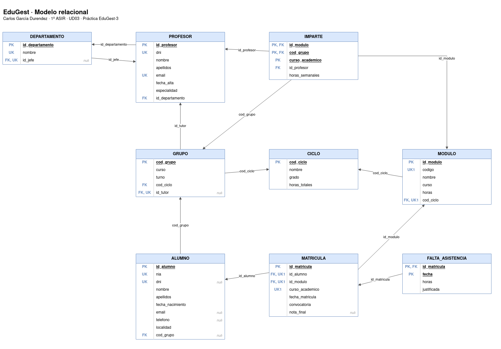

# EduGest · UD03 · Modelo relacional

| | |
|---|---|
| **Proyecto** | EduGest: gestión académica del IES Serra Gelada |
| **Práctica** | EduGest-3 (RA6: a, b, c, d, e, f, h) |
| **Autor** | Carlos García Durendez (1º ASIR semipresencial) |
| **Fecha** | 2026-11-15 |
| **Parte de** | [02-modelo-er.md](02-modelo-er.md) (modelo E/R de la práctica EduGest-2) |

---

## 1. Diagrama relacional



Fichero fuente: [03-modelo-relacional.drawio](03-modelo-relacional.drawio). Cada flecha va de la clave ajena a la tabla que referencia. *null* marca las columnas que admiten nulos.

---

## 2. Esquema relacional

Notación: **PK** clave primaria · **FK** clave ajena · **UK** clave alternativa · **VNN** valor no nulo. Las columnas que no aparecen en PK ni en VNN admiten nulos.

```text
DEPARTAMENTO (id_departamento, nombre, id_jefe)
   PK:  id_departamento
   UK:  nombre
   UK:  id_jefe
   FK:  id_jefe → PROFESOR
   VNN: nombre

PROFESOR (id_profesor, dni, nombre, apellidos, email, fecha_alta, especialidad, id_departamento)
   PK:  id_profesor
   UK:  dni
   UK:  email
   FK:  id_departamento → DEPARTAMENTO
   VNN: dni, nombre, apellidos, email, fecha_alta, especialidad, id_departamento

CICLO (cod_ciclo, nombre, grado, horas_totales)
   PK:  cod_ciclo
   VNN: nombre, grado, horas_totales

MODULO (id_modulo, codigo, nombre, curso, horas, cod_ciclo)
   PK:  id_modulo
   UK:  (codigo, cod_ciclo)
   FK:  cod_ciclo → CICLO
   VNN: codigo, nombre, curso, horas, cod_ciclo

GRUPO (cod_grupo, curso, turno, cod_ciclo, id_tutor)
   PK:  cod_grupo
   UK:  id_tutor
   FK:  cod_ciclo → CICLO
   FK:  id_tutor  → PROFESOR
   VNN: curso, turno, cod_ciclo

ALUMNO (id_alumno, nia, dni, nombre, apellidos, fecha_nacimiento, email, telefono, localidad, cod_grupo)
   PK:  id_alumno
   UK:  nia
   UK:  dni
   FK:  cod_grupo → GRUPO
   VNN: nia, nombre, apellidos, fecha_nacimiento, localidad

MATRICULA (id_matricula, id_alumno, id_modulo, curso_academico, fecha_matricula, convocatoria, nota_final)
   PK:  id_matricula
   UK:  (id_alumno, id_modulo, curso_academico)
   FK:  id_alumno → ALUMNO
   FK:  id_modulo → MODULO
   VNN: id_alumno, id_modulo, curso_academico, fecha_matricula, convocatoria

FALTA_ASISTENCIA (id_matricula, fecha, horas, justificada)
   PK:  (id_matricula, fecha)
   FK:  id_matricula → MATRICULA
   VNN: horas, justificada

IMPARTE (id_modulo, cod_grupo, curso_academico, id_profesor, horas_semanales)
   PK:  (id_modulo, cod_grupo, curso_academico)
   FK:  id_modulo   → MODULO
   FK:  cod_grupo   → GRUPO
   FK:  id_profesor → PROFESOR
   VNN: id_profesor, horas_semanales
```

**Columnas que admiten nulos:** `DEPARTAMENTO.id_jefe`, `GRUPO.id_tutor`, `ALUMNO.dni`, `ALUMNO.email`, `ALUMNO.telefono`, `ALUMNO.cod_grupo` y `MATRICULA.nota_final`.

**Claves ajenas cruzadas.** `DEPARTAMENTO.id_jefe → PROFESOR` y `PROFESOR.id_departamento → DEPARTAMENTO` se referencian mutuamente. En la UD05 se crearán las dos tablas y después se añadirá `id_jefe` con `ALTER TABLE`. Como `id_jefe` admite nulos, primero se da de alta el departamento sin jefe.

---

## 3. Trazabilidad E/R → relacional

| Elemento del E/R | Regla aplicada | Resultado en el modelo relacional |
|---|---|---|
| Entidades `DEPARTAMENTO`, `PROFESOR`, `CICLO`, `GRUPO`, `ALUMNO` | Entidad fuerte | Una tabla por entidad. El identificador pasa a PK y los alternativos a UK (`nombre`, `dni`, `email`, `nia`) |
| Entidad `MODULO` con (código, ciclo) único | Entidad fuerte + clave alternativa | `MODULO` con PK `id_modulo` y UK(`codigo`, `cod_ciclo`) |
| Entidad `MATRICULA` | Entidad fuerte | `MATRICULA` con PK `id_matricula` y UK(`id_alumno`, `id_modulo`, `curso_academico`) para que no se repita la matrícula |
| Entidad débil `FALTA_ASISTENCIA` (discriminante `fecha`) | Entidad débil por identificación | `FALTA_ASISTENCIA` con PK(`id_matricula`, `fecha`). `id_matricula` es también FK |
| `pertenece a` PROFESOR (1,1) – DEPARTAMENTO (0,N) | 1:N, la FK va al lado N | `id_departamento` en `PROFESOR`, con VNN porque el mínimo es 1 |
| `es jefe de`, 1:1 (0,1)–(0,1) | 1:1 opcional en los dos lados | `id_jefe` en `DEPARTAMENTO`: FK + UK, admite nulos |
| `tutoriza`, 1:1 (0,1)–(0,1) | 1:1 opcional en los dos lados | `id_tutor` en `GRUPO`: FK + UK, admite nulos |
| `organiza` CICLO (1,1) – GRUPO (0,N) | 1:N | `cod_ciclo` en `GRUPO`, con VNN |
| `se compone de` CICLO (1,1) – MODULO (0,N) | 1:N | `cod_ciclo` en `MODULO`, con VNN |
| `está en` GRUPO (0,1) – ALUMNO (0,N) | 1:N con FK opcional | `cod_grupo` en `ALUMNO`, admite nulos |
| `realiza` ALUMNO (1,1) – MATRICULA (0,N) | 1:N | `id_alumno` en `MATRICULA`, con VNN |
| `es objeto de` MODULO (1,1) – MATRICULA (0,N) | 1:N | `id_modulo` en `MATRICULA`, con VNN |
| `acumula` (identificadora) | Relación de la entidad débil | Ya incluida en la PK de `FALTA_ASISTENCIA`. No genera columnas nuevas |
| `IMPARTE` ternaria 1:N:M (lado 1 = PROFESOR) con atributo `curso_academico` | Ternaria 1:N:N: PK = claves de los lados N (+ el atributo que permite repetir) y la del lado 1 con VNN | `IMPARTE` con PK(`id_modulo`, `cod_grupo`, `curso_academico`) e `id_profesor` FK con VNN. Conserva profesor, módulo, grupo y curso académico |
| Atributos de la relación `IMPARTE` | Pasan a la tabla de la relación | `curso_academico` (parte de la PK) y `horas_semanales` |

**Pérdidas semánticas.** Todos los mínimos 1 del E/R están en el lado N de una 1:N y se cubren con VNN en la FK. Los mínimos 0 no necesitan nada. No hay pérdidas de cardinalidad. Las reglas que no caben en el esquema están en el apartado 5.

---

## 4. Política de borrado de las claves ajenas

| Clave ajena | Política | Justificación |
|---|---|---|
| `PROFESOR.id_departamento → DEPARTAMENTO` | Restringido | No se puede borrar un departamento con profesorado. Primero hay que reasignarlo |
| `DEPARTAMENTO.id_jefe → PROFESOR` | Puesta a nulos | Si se borra el profesor, el departamento queda sin jefe, que es una situación permitida (S7 de la UD02) |
| `GRUPO.id_tutor → PROFESOR` | Puesta a nulos | El grupo puede quedarse sin tutor hasta que se nombre otro |
| `GRUPO.cod_ciclo → CICLO` | Restringido | No se puede borrar un ciclo que tiene grupos |
| `MODULO.cod_ciclo → CICLO` | Restringido | Un ciclo con módulos tiene matrículas y docencia asociadas |
| `ALUMNO.cod_grupo → GRUPO` | Puesta a nulos | Si se borra un grupo, el alumnado queda sin grupo (permitido) y no se pierde ningún alumno |
| `MATRICULA.id_alumno → ALUMNO` | **Restringido** | La matrícula y la nota son **documentos oficiales**. No se puede borrar un alumno con expediente. Los antiguos alumnos se anonimizarán (UD08), no se borrarán |
| `MATRICULA.id_modulo → MODULO` | **Restringido** | Por el mismo motivo: borrar un módulo no puede hacer desaparecer notas |
| `FALTA_ASISTENCIA.id_matricula → MATRICULA` | En cascada | La falta es una entidad débil y no tiene sentido sin su matrícula. Una matrícula solo se puede borrar si no está protegida por las dos reglas anteriores, es decir, cuando se anula una matrícula hecha por error, y entonces sus faltas deben irse con ella |
| `IMPARTE.id_profesor → PROFESOR` | Restringido | No se borra a un profesor con docencia asignada. Antes hay que reasignar sus módulos |
| `IMPARTE.id_modulo → MODULO` | Restringido | Se conserva el histórico de quién impartió cada módulo |
| `IMPARTE.cod_grupo → GRUPO` | Restringido | No se borra un grupo con docencia asignada |

**Modificación.** Oracle no tiene `ON UPDATE CASCADE`, así que la modificación de claves queda restringida en todas las FK. No es un problema, porque las PK son identificadores internos o códigos estables (`cod_ciclo`, `cod_grupo`) que no deberían cambiar.

---

## 5. Restricciones no representables

Reglas que no se pueden declarar con PK, FK, UK ni VNN.

| # | Restricción | Tablas | Cuándo se comprueba | Implementación prevista |
|---|---|---|---|---|
| R1 | El jefe de un departamento debe pertenecer a ese departamento | `DEPARTAMENTO(id_jefe)`, `PROFESOR(id_departamento)` | Al asignar o cambiar el jefe y al cambiar de departamento a un profesor | Trigger (UD08) |
| R2 | Un alumno solo se matricula de módulos del ciclo de su grupo, salvo autorización | `MATRICULA`, `ALUMNO`, `GRUPO`, `MODULO` | Al insertar o modificar una matrícula | Trigger o procedimiento de matrícula (UD08) |
| R3 | No se registran faltas con fecha anterior a la fecha de matrícula | `FALTA_ASISTENCIA`, `MATRICULA` | Al insertar o modificar una falta | Trigger (UD08) |
| R4 | Un profesor no supera 20 horas lectivas semanales en un curso académico | `IMPARTE` (suma de `horas_semanales`) | Al insertar o modificar una fila de `IMPARTE` | Trigger compuesto o procedimiento (UD08) |
| R5 | La nota final solo se modifica si el curso académico de la matrícula está abierto | `MATRICULA` | Al modificar `nota_final` | Trigger (UD08) |
| R6 | En `IMPARTE`, el módulo es del mismo ciclo y curso que el grupo | `IMPARTE`, `MODULO`, `GRUPO` | Al insertar o modificar una fila de `IMPARTE` | Trigger (UD08) |

**Reglas de fila**, que se declararán como `CHECK` en la UD05: `nota_final` entre 0 y 10; `convocatoria` entre 1 y 4; `turno` en {M, T}; `grado` en {básico, medio, superior}; `curso` en {1, 2}; `horas`, `horas_totales` y `horas_semanales` mayores que 0; `justificada` en {S, N}; `curso_academico` con formato `AAAA-AA`.
